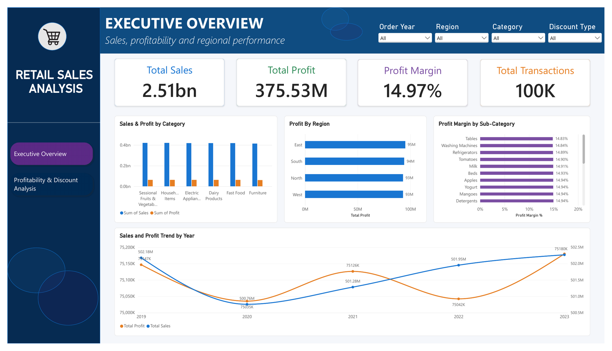
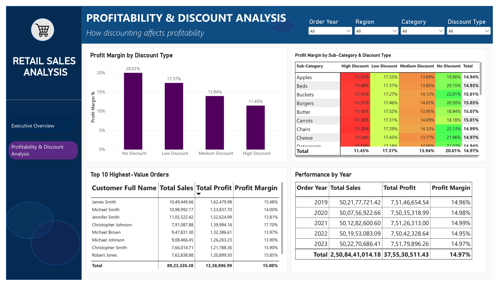

# Retail Sales & Profitability Analysis

An end-to-end analysis of 100,000 Indian retail transactions (2019–2023) to find what actually drives profit margin. Category, region and year turned out to be almost identical in margin. **Discount level is the one factor that moves profitability**, cutting margin from 20.0% to 11.5% as discounts deepen.

**Tools:** Excel · MySQL · Power BI

---

## Dashboard preview

**Page 1: Executive Overview**



**Page 2: Profitability & Discount Analysis**



---

## Business question

Which categories, regions or pricing practices are driving profit margin, and where should management act?

## Dataset

| | |
|---|---|
| Source | [Indian Store Data (Kaggle)](https://www.kaggle.com/datasets/abuhumzakhan/store-data) |
| Size | 100,000 transactions, 25 columns |
| Period | 2019–2023 |
| Currency | Indian Rupees (₹) |
| Coverage | 6 categories, 24 sub-categories, 4 regions, city tiers (Tier 1 / Tier 2 / Village), outlet types |
| Quality | No nulls, no duplicate rows |

## Approach

**1. Excel: data validation and first look**
- Checked nulls, duplicates and data types.
- Found that the provided `Year` column is unreliable (see [Data quality notes](#data-quality-notes)) and derived a correct `Order Year` from `Order Date`.
- Added calculated columns: `Order Year`, `Discount %`, `Discount Type` (No / Low / Medium / High) and `Profit Margin %`.
- Built pivot tables by category, sub-category, region, discount type and year, plus a category × discount-type cross-tab.

**2. MySQL: formal analysis**
- Total sales, profit and margin; category and sub-category profitability.
- `RANK() OVER (PARTITION BY ...)` to rank sub-categories by profit within each category.
- A CTE to isolate low-margin segments.
- `CASE`-based discount tiers and a sub-category × discount cross-analysis.
- Regional view by state, city tier and outlet type; yearly trend using `YEAR(Order Date)`.

**3. Power BI: interactive dashboard**
- Two pages, with slicers for Order Year, Region, Category and Discount Type.
- DAX measures: Total Sales, Total Profit, Total Transactions, and `Profit Margin % = DIVIDE([Total Profit], [Total Sales])`.
- Sub-category × discount-type matrix with conditional formatting.

## Key findings

**1. Overall performance:** ₹2.51bn sales, ₹375.5M profit, **14.97% margin** across 100,000 transactions.

**2. Category, region and year are essentially flat.** I expected one of them to be the problem, but none is:

| Dimension | Margin range |
|---|---|
| 6 categories | 14.9% – 15.0% |
| 24 sub-categories | ≈ 14.8% – 15.2% |
| 4 regions | 14.9% – 15.0% |

| Year | Sales | Profit | Margin |
|---|---|---|---|
| 2019 | ₹502.18M | ₹75.15M | 14.96% |
| 2020 | ₹500.76M | ₹75.04M | 14.98% |
| 2021 | ₹501.28M | ₹75.13M | 14.99% |
| 2022 | ₹501.95M | ₹75.04M | 14.95% |
| 2023 | ₹502.27M | ₹75.18M | 14.97% |

The business is stable. Neither revenue nor margin grew or declined over five years.

**3. Discount level is the real driver.** Margin falls steadily as discounts deepen:

| Discount tier | Discount range | Orders | Profit margin |
|---|---|---|---|
| No discount | 0% | 949 | **20.01%** |
| Low | 1–25% | 49,575 | 17.37% |
| Medium | 26–35% | 20,119 | 13.94% |
| High | 36–50% | 29,357 | **11.45%** |

The pattern is the same in every category, so it is a company-wide issue and not one product line's.

**4. Discounting is the norm, not the exception.** Only 0.9% of orders carry no discount, while 29.4% carry a 36–50% discount.

## Recommendation

- **Don't restructure the product mix or regional footprint.** Margins are uniform, so those changes are unlikely to improve profitability.
- **Review and cap discounts in the 36–50% tier.** It covers nearly 30% of orders and has the lowest margin. Start by understanding why these discounts are issued.
- **Track margin by discount tier as a standing KPI** on the dashboard.

## Data quality notes

- **`Year` column ignored.** It disagrees with the actual year of `Order Date` in 80,023 of 100,000 rows (e.g. an order placed in 2020 is labelled 2023). All yearly analysis uses `Order Year` derived from `Order Date`.
- **`Order Date` is the single trusted date.** It is consistent with `Ship Date` (shipping never precedes ordering). `Sales Date` conflicts with it and was not used.
- **`Country` is constant (India)** and carries no information.
- **No repeat customers.** Every `Customer ID` appears exactly once, and customer names repeat across *different* IDs (e.g. "Michael Smith" appears 59 times under 59 different IDs). The "Top 10 Highest-Value Orders" panel groups by name, so it should be read as a list of high-value orders and not as customer loyalty. Loyalty or repeat-purchase analysis isn't possible with this data.
- **Margin definition.** Excel pivots show the *average of row-level margins*, while SQL and Power BI use `SUM(Profit) / SUM(Sales)` (sales-weighted). The two differ slightly in the second decimal place.
- **Unusually uniform data.** Margins are near-identical across every category, region and year, which suggests the data may be simulated. Treat the conclusions as a demonstration of method and not as a real company's results.

## Repository structure

```
retail-sales-profitability-analysis/
├── README.md
├── images/
│   ├── executive_overview.png
│   └── profitability_discount_analysis.png
├── excel/
│   └── store_sales_data_updated.xlsx      # cleaned data + calculated columns + pivot tables
├── sql/
│   └── retail_sales_project.sql           # all MySQL queries
└── powerbi/
    ├── Retail_Store_Analysis_Project.pbix
    └── Retail_Store_Analysis_Project.pdf  # exported dashboard
```

## How to reproduce

1. Download the dataset from [Kaggle](https://www.kaggle.com/datasets/abuhumzakhan/store-data).
2. **Excel:** open `excel/store_sales_data_updated.xlsx` to see the added columns and pivot tables.
3. **MySQL:** import the raw CSV into a table named `store_sales_data_original`, then run `sql/retail_sales_project.sql`.
4. **Power BI:** open the `.pbix` file in Power BI Desktop (it connects to the Excel workbook; re-point the data source if the file path differs).

## What I'd do next

- **Test whether deep discounts earn their cost.** Check whether higher discounts actually increase quantity or sales. If they don't, the margin given up is a pure loss.
- **Find out where deep discounts are applied** (by outlet type, city tier, segment, ship mode) to target a policy change precisely.
- **Add statistical validation in Python** (e.g. a hypothesis test on discount tier vs. margin) to complement the descriptive analysis.

## Skills demonstrated

Data validation and cleaning · Pivot tables · SQL aggregation, `CASE` logic, CTEs and window functions · DAX measures · Dashboard design and conditional formatting · Translating findings into business recommendations

## Author

**Mihir Kavde**: Aspiring Data Analyst
[LinkedIn](https://www.linkedin.com/in/MihirKavde/) · [GitHub](https://github.com/MihirKavde) · mihirkavde@gmail.com
